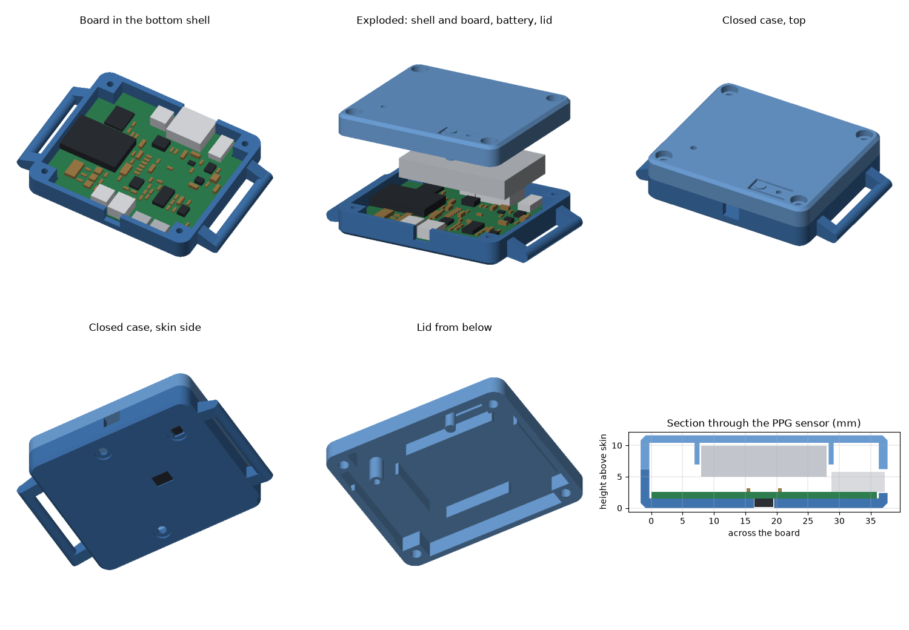

# Hardware — rev A

Plan and part choices: [PLAN.md](PLAN.md). This folder holds the rev A schematic, the
routed 36 × 42 mm board, the case and the manufacturing files.

| Path | What |
|---|---|
| `tools/gen_schematic.py` | **The circuit.** Every part, value, footprint and pin→net. Edit this, not the `.kicad_sch` files. |
| `tools/customlib.py`, `tools/footprints.py` | Symbols and footprints KiCad doesn't ship. |
| `tools/kicadgen.py`, `tools/sexpr.py` | Schematic generator (labels on every pin, no hand-drawn wires). |
| `tools/verify_netlist.py` | Checks KiCad's exported netlist pin-by-pin against the design. |
| `tools/board_geometry.py` | **The mechanical numbers** shared by the board and the case: outline, connector and sensor positions, battery. |
| `tools/gen_pcb.py` | **The board.** Placement table, outline, keep-outs, planes, plane vias, autorouting (Freerouting 1.9.0) and import. Run with KiCad's Python. |
| `tools/gen_case.py`, `tools/preview_case.py` | **The case.** Bottom shell and lid as STL, an interference check against the placed parts, and preview images. |
| `tools/export_fab.py` | Runs DRC, then writes Gerbers, drill, placement, BOM, renders and STEP into `fab/`. |
| `kicad/` | Generated KiCad 10 project: schematic sheets, `wearable.kicad_pcb`, project libraries. |
| `case/` | `bottom_shell.stl`, `lid.stl`, `case_preview.png`. |
| `fab/` | Manufacturing outputs (see below). |
| `datasheets/` | Put vendor PDFs here (not committed). |

## Regenerate and check

```bash
KPY="<KiCad>/bin/python.exe"     # KiCad's own Python, it provides pcbnew
python hardware/tools/footprints.py
python hardware/tools/gen_schematic.py
kicad-cli sch erc --severity-all hardware/kicad/wearable.kicad_sch
kicad-cli sch export netlist --format kicadsexpr -o hardware/kicad/wearable.net hardware/kicad/wearable.kicad_sch
python hardware/tools/verify_netlist.py hardware/kicad/wearable.net
"$KPY" hardware/tools/gen_pcb.py route     # place, fan out power pads, autoroute, import, fill
"$KPY" hardware/tools/gen_pcb.py dump      # part boxes for the case fit check
python hardware/tools/export_fab.py        # DRC gate + manufacturing files
python hardware/tools/preview_case.py      # case STLs, fit check, preview (needs manifold3d, trimesh, matplotlib)
```

Status on 2026-11-11:
- **Schematic:** ERC 0 errors, 0 warnings. Netlist check: 56 nets and 276 pins match the design.
- **Board:** fully routed. KiCad DRC with schematic parity: **0 violations, 0 unconnected
  nets, 0 parity issues.** 4 layers, 1.0 mm, 83 footprints (74 fitted), about 1.3 m of
  track and 159 vias.
- **Case:** both parts watertight; no interference between the case and any placed part
  or the battery.
- **Pinouts:** all 5 custom symbols checked against the vendor datasheets.

## Board

- **Stack-up:** F.Cu signals + GND pour, In1 solid GND plane, In2 solid +1V8 plane,
  B.Cu signals + GND pour.
- **Rules:** 0.127 mm tracks / 0.1 mm clearance (needed between the module's staggered
  pads and at the 0.4 mm-pitch charger), power nets 0.25 mm, vias 0.45/0.2 mm and
  0.5/0.25 mm, 0.3 mm copper-to-edge.
- **Antenna:** the module sits at the Y = 0 edge. No copper on any layer in a strip
  27 mm wide by 3.75 mm deep under and beside the antenna.
- **Top side:** everything except the two skin sensors. Parts under the battery are at
  most 2.1 mm tall.
- **Skin side:** MAXM86161 at the board centre, TMP117 inside a pour-free 4 × 4 mm area,
  six SWD test pads (GND, 1V8, DIO, CLK, RST, SWO) at 2.54 mm pitch.
- **Electrodes:** two plated M2 holes, 29 mm apart. E2 (sense) is on the jack side, E1
  (driven) on the USB side.
- **Corners:** 4.4 mm notches for the case's screw posts.
- **How it was routed:** `gen_pcb.py` gives every GND and +1V8 pad its own via to the
  plane first and locks those, then Freerouting routes the signals around them. Routing
  is autorouted, not hand-tuned: it passes DRC, but see "Review before ordering".

## Case

Two printed parts, sized for an ordered SLA or MJF print (1.4 mm walls, 1.2 mm lid).
Outside: 39.4 × 57.0 × 11.6 mm including the strap bars (45.4 mm long without them).

- **Bottom shell:** the board sits on the floor, held by the two electrode screws. Openings:
  PPG window, TMP117 pocket with a 5 mm recess for a metal contact disc, two electrode
  screw holes, USB-C notch, electrode-jack notch. A 3 mm round bar at each end takes a
  20 mm strap.
- **Lid:** ribs hold the 502030 cell 2.4 mm above the board. A flexing tab with a post
  presses the USER switch, a pinhole reaches RESET, and a tube over the LED ends in a
  1.6 mm hole.
- **Hardware:** 4 × M2×8 self-tapping screws (lid), 2 × stainless M2×5 pan-head screws
  with nuts (electrodes), thin double-sided tape for the battery.
- **Heights above the skin:** board 1.55–2.55 mm, lid joint 6.2 mm, battery 4.95–9.95 mm,
  top 11.6 mm. The PPG face sits 0.15 mm inside the floor.



## Manufacturing files (`fab/`)

| File | Use |
|---|---|
| `wearable_revA_gerbers.zip` | Gerbers for all 4 copper layers, mask, paste, silkscreen, outline, plus PTH and NPTH drill files. |
| `wearable_revA_cpl.csv` | Component placement in JLCPCB's column layout (72 top, 2 bottom). |
| `wearable_revA_bom.csv` | BOM in JLCPCB's column layout. **The LCSC column is still empty.** |
| `wearable_revA_schematic.pdf`, `board_top.png`, `board_bottom.png`, `wearable_revA_board.step` | Reference. |

Order settings: 4 layers, 1.0 mm, ENIG (the electrode and test pads are bare), assembly
on both sides.

## Review before ordering

1. **LCSC part numbers and stock** for all 48 BOM lines. The MAXM86161, MDBT50Q and
   BQ25180 may not be stocked by JLCPCB and may need to be consigned or hand-soldered.
2. **Fab capability:** 0.2 mm via drills, 0.1 mm clearance and the 0.4 mm-pitch BQ25180
   are inside JLCPCB's published 4-layer limits but can add cost. Confirm when quoting.
3. **Placement rotations** in JLCPCB's preview: their rotation convention differs from
   KiCad's for some packages.
4. **A look at the routing in KiCad:** the crystal traces are 9–10 mm and power runs at
   0.25 mm width. Both are workable; an experienced eye may want to tidy them.
5. **RF:** antenna performance on the wrist is not simulated or measured. Raytac offers a
   free layout review.
6. **Case:** not printed yet. Clearances are 0.3 mm around the board and 0.15 mm around
   the PPG, and the button tab and strap bars are untested.
7. **PPG window:** the opening follows the package body. The LED and photodiode positions
   from outline 21-100309 are still not checked.
8. **Battery polarity:** pad 1 (marked +) is battery positive. A reversed cell destroys
   the charger.

## Blocks

- **Power:** USB-C (5.1 kΩ Rd, USBLC6 ESD) → **BQ25180** charger with power path → `VSYS` (3.0–4.5 V)
  → **TPS62840** buck → `+1V8`, which powers *all* logic. **MAX17048** gauge on `VBAT`.
  10 k NTC on TS. Two solder pads for the battery leads. Test points on every rail.
- **MCU:** **MDBT50Q-1MV2** (nRF52840) in normal-voltage mode (VDD = VDDH = 1.8 V). 32.768 kHz
  crystal. **W25Q128JW** 16 MB 1.8 V QSPI flash. 2.2 kΩ I²C pull-ups, 47 kΩ pull-ups on the
  open-drain interrupts. Six SWD test pads on the skin side (use a 2.54 mm pogo clip).
  Reset + user buttons. Common-anode RGB LED on VSYS through 1.8 V-drivable FETs.
  **Pins follow the Adafruit Feather nRF52840 Express** (QSPI P0.17/19–23, SDA P0.12, SCL
  P0.11, button P1.02, LEDs P1.15/P1.10/P0.16), so its UF2 bootloader and Arduino variant
  work for first bring-up.
- **Sensors (one 400 kHz I²C bus):** MAXM86161 0x62, BMI270 0x68, TMP117 0x48,
  BQ25180 0x6A, MAX17048 0x36. No address conflicts. Every device's VIH is ≤ 1.4 V, so
  1.8 V pull-ups work for all of them.
- **PPG:** the MAXM86161 is single-supply. It runs from VLED = VSYS (3.0–5.5 V) and makes
  its own 1.8 V internally (VLDO), so it never loads `+1V8`. LDO_EN is driven by
  `PPG_EN` (P0.13) with a 100 k pull-down, so the module is fully off (≈0.05 µA) until
  firmware enables it. Pins 6–8 are the LED driver nodes: soldered down, connected to
  nothing. The MAXM86161A is a drop-in alternative (same pinout and land pattern).
- **EDA:** a 909k/499k/402k 0.1 % divider gives 0.90 V (TIA reference) and 0.40 V
  (excitation), so the skin sees 0.50 V. LPV812 half A holds electrode E1 at 0.40 V, with
  the loop closed at the electrode so the 10 kΩ protection resistor causes no error. Half B
  is a TIA: 392 kΩ for 0–4.3 µS, plus 43.2 kΩ switched in by TS5A3166 for 0–44 µS. The ADC
  reads EDA_OUT, EDA_VREF and EDA_VEXC_SET, which allows ratiometric calibration. The
  electrodes are two stainless M2 screws through the case floor, with a JST-SH jack for
  finger electrodes and TPD1E05U06 ESD diodes.

### nRF52840 pin map

| Pin | Net | Pin | Net |
|---|---|---|---|
| P0.00/P0.01 | 32 kHz crystal | P0.04 (AIN2) | EDA_OUT |
| P0.11 / P0.12 | I2C_SCL / I2C_SDA | P0.05 (AIN3) | EDA_VREF |
| P0.17,22,23,21 | QSPI IO0–IO3 | P0.30 (AIN6) | EDA_VEXC_SET |
| P0.19 / P0.20 | QSPI SCK / CS | P1.08 | EDA_RANGE |
| P0.18 | nRESET | P0.07 | PPG_INT |
| P1.00 | SWO | P0.26 / P0.27 | IMU_INT1 / INT2 |
| P1.02 | BTN_USER | P0.06 | GAUGE_ALRT |
| P1.15 / P0.16 / P1.10 | LED R / G / B | P0.08 | CHG_INT |
| P0.02,03,28,31,24,25 | not connected | P1.09 | TEMP_ALERT |
| P0.13 | PPG_EN (MAXM86161 LDO_EN) | | |

## Datasheet verification (2026-11-09)

| Part | Checked | Result / change |
|---|---|---|
| BQ25180 | Table 6-1, §9.2, YBG0008 drawing | Ball map **corrected** (A1 /INT, A2 IN, B1 SCL, B2 SYS, C1 SDA, C2 BAT, D1 TS/MR, D2 GND). TS biased internally (38 µA): NTC only. IN 1–10 µF and SYS 10 µF, both 25 V rated. VIH 1.3 V. Footprint drawn: 0.4 mm pitch, all balls on the perimeter. |
| TPS62840 | Pin Functions (DLC), Table 1, Table 2 | Pin order **corrected** (1 GND, 2 VIN, 3 MODE, 4 EN, 5 VSET, 6 STOP, 7 SW, 8 VOS). VSET to GND = 1.8 V, so R3 = 0 Ω. Inductor changed to the datasheet part DFE201612E-2R2M. |
| MAXM86161 | Pin Description, app circuit, layout guide | Pinout **corrected**. It's single-supply (VLED + internal LDO), with VLDO/VREF 1 µF each and VLED 10 µF. LDO_EN is now on a GPIO. VIH 1.4 V. |
| MAX17048 | Pin table (TDFN), EC table | Pinout confirmed. VIH 1.4 V. KiCad footprint drawn from Maxim 21-0168. |
| BMI270 | Table 22 | Pinout identical to the BMI160. Unused ASDx/ASCx/OCSB/OSDO may be left unconnected (never tied to GND). |
| MDBT50Q-1MV2 | §8 reference circuits | Normal-voltage mode confirmed (VDDH = VDD, DCCH open). 12 pF crystal caps match. Raytac shows 27 Ω on D+/D−, so R25/R26 were added as 0 Ω options. |
